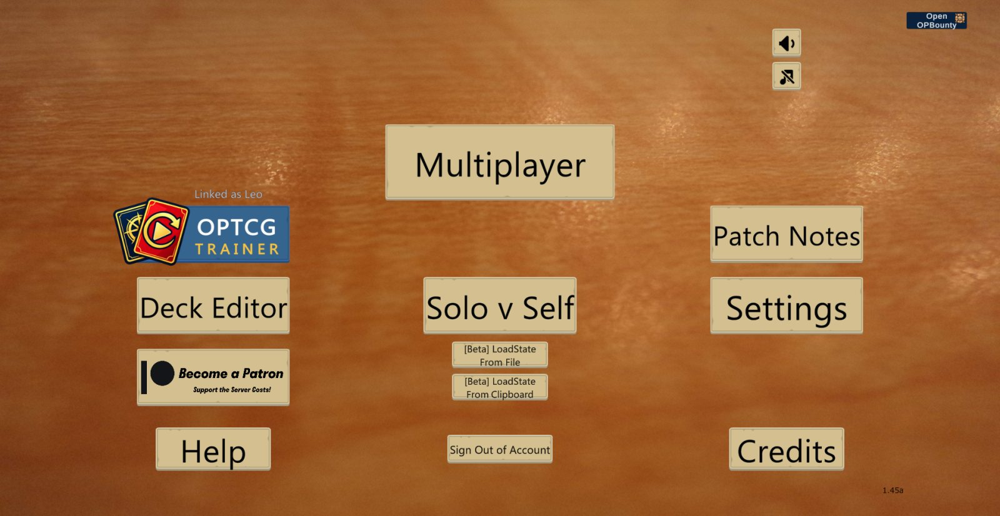
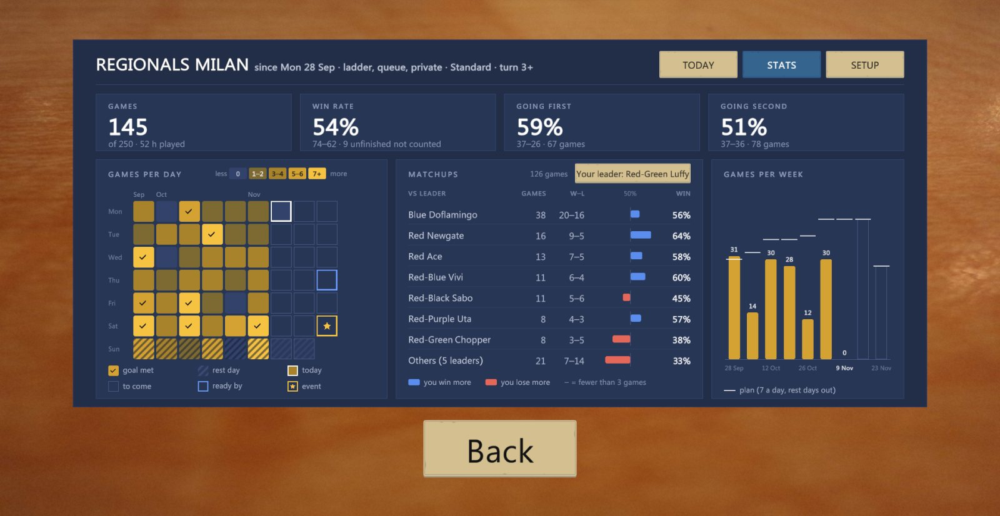
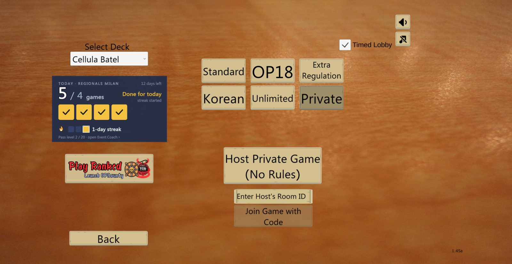
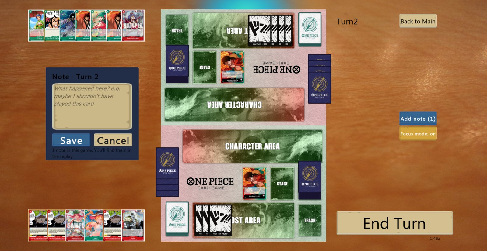
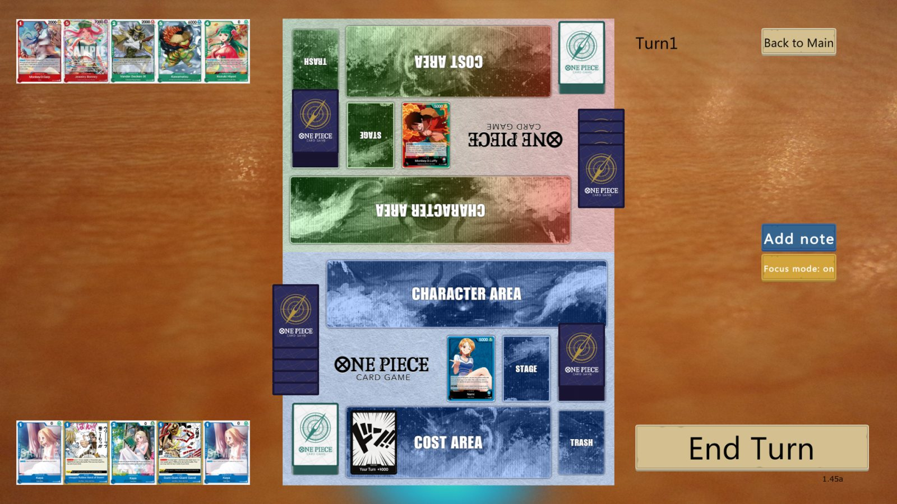
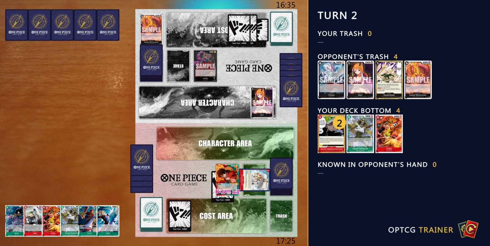
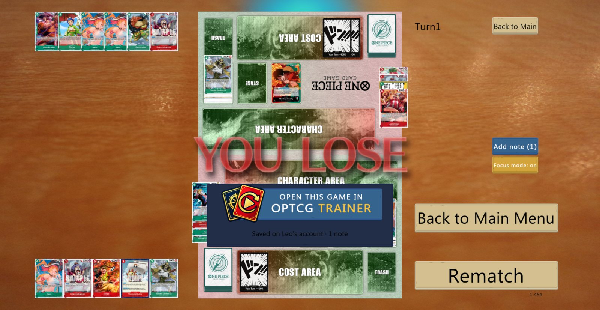

# OPTCG Trainer for OPTCGSim

A mod for [OPTCGSim](https://optcgsim.com) that brings [OPTCG Trainer](https://optcgtrainer.com) inside the sim:
train for your next event with the Event Coach, write notes while you play, play in Focus mode, save a picture of the
game to share, and find every game already on your OPTCG Trainer account, with your notes at the right moment.

> **Beta.** Windows only. This is an unofficial fan project, not made or endorsed by Batsu (OPTCGSim) or Bandai.



## Install (1 minute)

1. Download **`Install.OPTCG.Trainer.cmd`** from the [Releases page](https://github.com/LeoBacca/optcg-trainer-mod/releases) (the newest one is at the top).
2. Close OPTCGSim, then double-click **`Install.OPTCG.Trainer.cmd`** (no zip to extract).
   - If Chrome asks to keep the file, press **Keep**. If Windows SmartScreen appears, click **More info → Run anyway**.
   - It downloads the latest version, finds your OPTCGSim by itself and installs/updates automatically (if you have more than one, pick the one you play with).
3. Open **OPTCGSim** just like before (or **OPTCGSim + Trainer** from your desktop / Start menu).
4. In the main menu press the blue **OPTCG TRAINER** button. Your browser opens OPTCG Trainer: check the code is the same
   you see in the sim and press **Link**. You do this once.

That's it. Play as usual. (Prefer manual install? The full `OPTCG-Trainer-x.y.z.zip` is also attached to every release.)

## What you get

**Replay Room.** Open **Replay Room** from the main menu and choose **Watch** beside a match, or press **Watch replay** on the results screen. Use **Share link** to make a replay public and copy its link. Paste a friend's link into **Watch Shared Replay** to play it in the sim. **Delete** asks for confirmation before removing the selected match's local log files from your PC. Existing public links still work.

**Event Coach.** Getting ready for a regional? Set the event date, the day you want to be ready by and how many games
you want to play: the coach works out how many games a day, and keeps track of them inside OPTCGSim.
Open it from *Settings › EVENT COACH* (once your event is set, it's in the main menu too).
- *Today*: today's games, your streak of days (rest days you plan don't break it) and a 20-level pass up to EVENT READY.
- *Stats*: a calendar of the games you played, win rate going first and second, **your decks** (win rate of every
  leader you played: click one to see its matchups), matchups by opponent leader, games per week against your plan.
- Today's goal is right there on the Private screen, and at the end of each game a line tells you if it counted, with
  three buttons: **WON · LOST · DON'T COUNT**. The result read from the log is already lit: click to change it.
- Lost the connection, or the game froze? The game still counts, and in *Today* you say if you **won or lost** it.
  *Edit* fixes a wrong result, and *+ Add game* adds a game the mod didn't record.
- Your opponent left in the middle of a game? It's a win, and it counts (before 0.5.0 it was dropped as Solo v Self).
- Multiplayer games count whether OPTCGSim's *Hide Player Names* option is on or off (before 0.5.2, with names shown, which
  is the default, every multiplayer game said "too short (turn 0), not counted"). Games the mod recorded are read again by
  themselves. If you added those games with *+ ADD GAME*, you now see them twice: remove the copies with *edit → REMOVE*.
- **Games on other simulators** (from 0.5.0): log them by hand in the OPTCG Trainer Chrome extension and they count in
  the same coach. The extension shows the same goal of the day.

Games count if you play them with the mod, in the event format, and they reach turn 3 (ladder, queue and private;
Solo v Self if you want). The coach lives on your PC, in `%LOCALAPPDATA%\OPTCGTrainer\coach.json`. If the sim is linked
to your account, from 0.5.0 the mod also sends optcgtrainer.com a summary of your plan (the event, and how many games,
wins and losses each day: no names, no logs), so the extension can show it, and downloads the games you logged there.





**Notes while you play.** *Add note* opens a box over the log: write what you're thinking
(*"maybe I shouldn't have played X here"*). The note is pinned to that exact moment of the game, even if the game goes on
while you type, and you'll find it there in the replay.



**Focus mode.** Only the board, the choices, Back to Main and Concede, in full screen (like F11 in a browser).
No log, no chat. Press **Esc** or *Exit focus mode* to go back. It stays on for your next games until you turn it off.



**A picture to share.** The camera icon in the bottom-right corner saves a picture made for Discord or your coach:
the board, plus what a screenshot doesn't show — both trashes, the cards you put at the bottom of your deck, and the cards
you know are in your opponent's hand. Copies of the same card are stacked with a number. It goes to *Pictures › OPTCG Trainer*.



It only shows what you really know: the deck bottom is the cards you put there one by one (a shuffle clears it);
a card in your opponent's hand is known only if it came from the board or the trash, or it was revealed.

**Your games on your account.** When a game ends it goes to your OPTCG Trainer account by itself, with your notes.
*Open this game in OPTCG Trainer* opens the replay. Games you leave halfway (Back to Main) are uploaded too.
Each game also knows its type: ladder (OPBounty), queue, private lobby or Solo, and the queue (Standard, OP18…),
so on OPTCG Trainer you can filter your games by type. A game is "ladder" when it's a private lobby with the timer
played while the OPBounty program is open (or when it comes from the OPBounty panel inside the game).
A copy of every game log is also kept in `%LOCALAPPDATA%\OPTCGTrainer\logs`: OPTCGSim updates delete its own `CombatLogs` folder.

**A cleaner Multiplayer screen.** The sponsor banner, *TCG Match Making* (Discord), *Match History* and the
*Open OPBounty* button at the top right are hidden: *Play Ranked / Launch OPBounty* and everything else stay. To bring them back, set `HideExtras = false` under `[Multiplayer]`
in `%LOCALAPPDATA%\OPTCGTrainer\BepInEx\config\com.optcgtrainer.mod.cfg`.

**OPBounty room codes pasted for you.** When the OPBounty program copies a room code for you (*PLEASE PASTE LOBBY CODE*),
the mod puts it in the code field of the Private screen (the one *Multiplayer* opens). You still press the button to enter.
The mod only reads that code: it never talks to OPBounty. And the mod keeps its own log lines out of the game's `Player.log`
(the file OPBounty reads): its own log is `%LOCALAPPDATA%\OPTCGTrainer\BepInEx\LogOutput.log`.



## What it changes on your PC

- **In your OPTCGSim folder: one file, `winhttp.dll`** (Unity Doorstop, the loader used by BepInEx). Nothing of OPTCGSim is modified.
- Everything else is in `%LOCALAPPDATA%\OPTCGTrainer`: BepInEx, the mod, your notes, the log copies.
- A shortcut on your desktop and in the Start menu: *OPTCGSim + Trainer*.

## What it doesn't do

- It doesn't change the rules, the cards, the network or anything that decides a game. It only adds buttons and panels on your screen.
- It never writes into OPTCGSim's own game log.
- It talks to `optcgtrainer.com` only after you link your account: it uploads your game logs (with the game type) and your notes, nothing else.
  The link can be removed any time from OPTCG Trainer → Settings → *OPTCGSim linked*.
- When OPTCGSim starts it asks GitHub (this page) if there's a newer version of the mod. It sends nothing about you or your games.
- The code is all here: read it, build it yourself if you prefer.

## Updating the mod (from 0.4.0)

When a new version is out, the small line above the **OPTCG TRAINER** button says **Update to x.y.z: click here**.
Click it: the mod downloads only its own file (`OPTCGTrainer.dll`) from the Releases page, checks it's exactly the one published
there, and puts it in place. Then restart OPTCGSim. Nothing is downloaded until you click, and your notes and link stay as they are.

Don't want it to ask? Set `Check = false` under `[Updates]` in `%LOCALAPPDATA%\OPTCGTrainer\BepInEx\config\com.optcgtrainer.mod.cfg`.
On 0.3.x there's no such line: download the new zip once and run **Install OPTCG Trainer** again.

## When OPTCGSim updates

The mod survives updates: OPTCGSim's patcher keeps `winhttp.dll`, and the rest is outside its folder.
From 0.5.1 the mod should also come back by itself when the patcher restarts OPTCGSim after the update (before, that restart
opened OPTCGSim without the mod). If it doesn't, close OPTCGSim and open it from the **OPTCGSim + Trainer** shortcut.
How: while OPTCGSim updates, the mod leaves a small `doorstop_config.ini` in the patcher's new files, so the restarted OPTCGSim
loads it; the mod deletes that file as soon as it starts, so opening `OPTCGSim.exe` directly still starts the game without the mod.
No OPTCGSim file is changed.
If an update changes something the mod uses, that part turns itself off and a small line at the top of the screen says so;
OPTCGSim keeps working as usual. When a fixed version is out, the update line above the OPTCG TRAINER button offers it.

## Uninstall

Double-click **`Uninstall OPTCG Trainer`** (in the folder you extracted). It removes `winhttp.dll`, the shortcuts and
the mod. Your notes and log copies stay in `%LOCALAPPDATA%\OPTCGTrainer`: delete that folder to remove them too.

## Problems?

Open an issue here, and attach `%LOCALAPPDATA%\OPTCGTrainer\BepInEx\LogOutput.log`.
Some antivirus programs dislike `winhttp.dll` because it loads mods into a game: it's the standard
[Unity Doorstop](https://github.com/NeighTools/UnityDoorstop) file shipped with [BepInEx](https://github.com/BepInEx/BepInEx).

## For developers

The mod is a [BepInEx 5](https://github.com/BepInEx/BepInEx) plugin ([HarmonyX](https://github.com/BepInEx/HarmonyX) patches),
built against your own copy of OPTCGSim (its DLLs are not in this repo):

```sh
dotnet build plugin -c Release -p:SimDir="C:\path\to\OPTCGSim" -p:BepInExCore="C:\path\to\BepInEx\core" -p:DevTools=false
```

- `plugin/` — the mod. Comments are in Italian.
- `installer/` — the install / uninstall scripts. `tools/pacchetto.ps1` builds the release zip.
- How the mod talks to optcgtrainer.com (device linking, uploads) is in `docs/site-api.md`.

License: MIT. Bundled third-party parts and their licenses are listed in the release zip (`files/licenses`).
