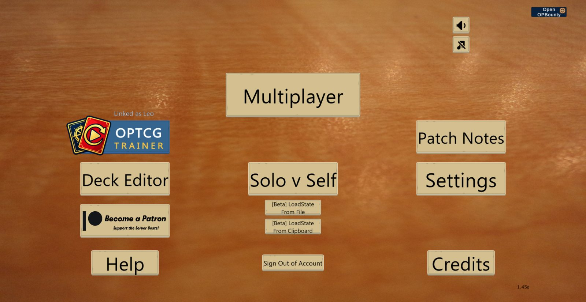
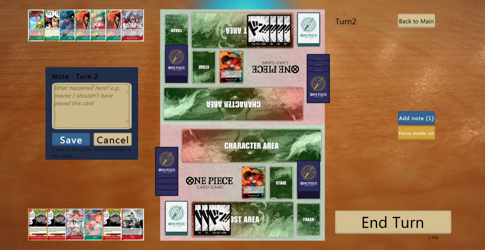
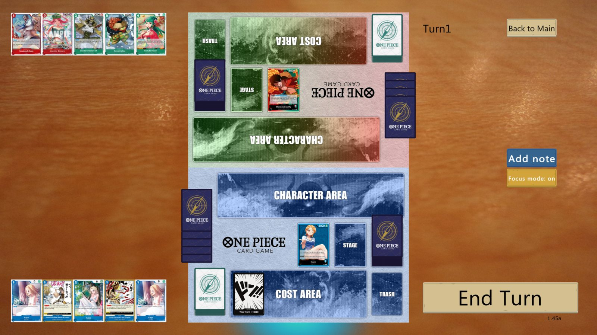
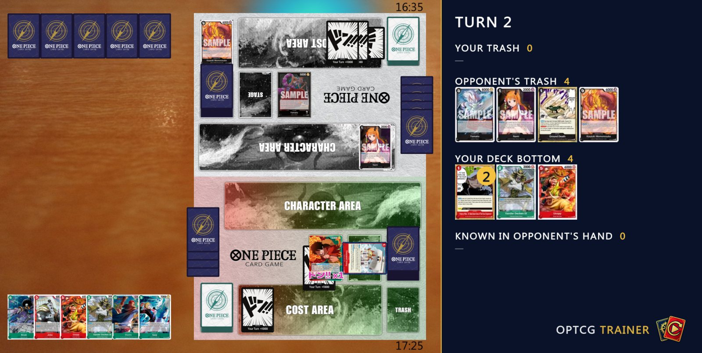
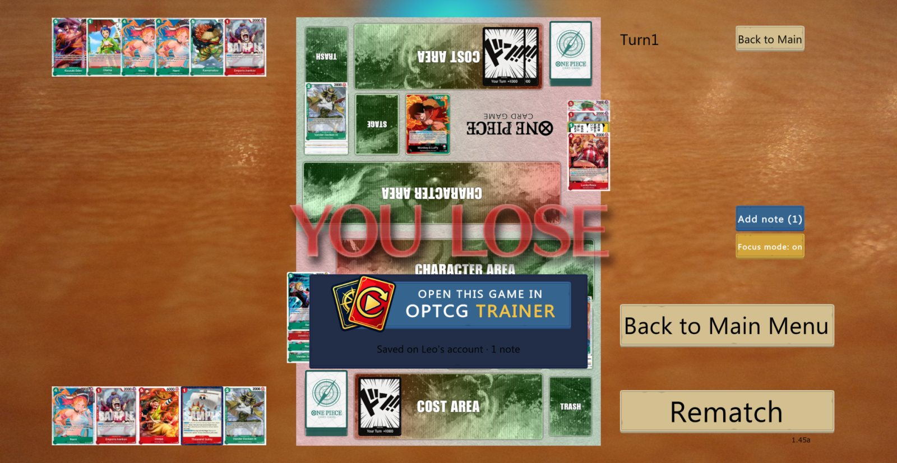

# OPTCG Trainer for OPTCGSim

A mod for [OPTCGSim](https://optcgsim.com) that brings [OPTCG Trainer](https://optcgtrainer.com) inside the sim:
write notes while you play, play in Focus mode, save a picture of the game to share, and find every game
already on your OPTCG Trainer account, with your notes at the right moment.

> **Beta.** Windows only. This is an unofficial fan project, not made or endorsed by Batsu (OPTCGSim) or Bandai.



## Install (2 minutes)

1. Download **`OPTCG-Trainer-x.y.z.zip`** from the [Releases page](https://github.com/LeoBacca/optcg-trainer-mod/releases) (the newest one is at the top).
2. Right-click the zip → **Extract All…** → **Extract**.
3. Close OPTCGSim, then double-click **`Install OPTCG Trainer`** in the extracted folder.
   - If Windows asks *"Do you want to run this file?"* press **Run**.
   - It finds your OPTCGSim by itself. If you have more than one, pick the one you play with.
4. Open **OPTCGSim + Trainer** from your desktop or the Start menu. **Use it from now on**: the usual OPTCGSim still starts without the mod.
   (To pin it to the taskbar: right-click it → *Pin to taskbar*.)
5. In the main menu press the blue **OPTCG TRAINER** button. Your browser opens OPTCG Trainer: check the code is the same
   you see in the sim and press **Link**. You do this once.

That's it. Play as usual.

## What you get

**Notes while you play.** *Add note* opens a box over the log: write what you're thinking
(*"maybe I shouldn't have played X here"*). The note is pinned to that exact moment of the game, even if the game goes on
while you type, and you'll find it there in the replay.



**Focus mode.** Only the board, the choices, Back to Main and Concede, in full screen (like F11 in a browser).
No log, no chat. Press **Esc** or *Exit focus mode* to go back. It stays on for your next games until you turn it off.



**A picture to share.** The camera icon in the bottom-right corner saves a picture made for Discord or your coach:
the board, plus what a screenshot doesn't show — both trashes, the cards you put at the bottom of your deck, and the cards
you know are in your opponent's hand. Copies of the same card are stacked with a number. It goes to *Pictures › OPTCG Trainer*.



It only shows what you really know: the deck bottom is the cards you put there one by one (a shuffle clears it);
a card in your opponent's hand is known only if it came from the board or the trash, or it was revealed.

**Your games on your account.** When a game ends it goes to your OPTCG Trainer account by itself, with your notes.
*Open this game in OPTCG Trainer* opens the replay. Games you leave halfway (Back to Main) are uploaded too.
A copy of every game log is also kept in `%LOCALAPPDATA%\OPTCGTrainer\logs`: OPTCGSim updates delete its own `CombatLogs` folder.



## What it changes on your PC

- **In your OPTCGSim folder: one file, `winhttp.dll`** (Unity Doorstop, the loader used by BepInEx). Nothing of OPTCGSim is modified.
- Everything else is in `%LOCALAPPDATA%\OPTCGTrainer`: BepInEx, the mod, your notes, the log copies.
- A shortcut on your desktop and in the Start menu: *OPTCGSim + Trainer*.

## What it doesn't do

- It doesn't change the rules, the cards, the network or anything that decides a game. It only adds buttons and panels on your screen.
- It never writes into OPTCGSim's own game log.
- It only talks to `optcgtrainer.com`, and only after you link your account: it uploads your game logs and your notes, nothing else.
  The link can be removed any time from OPTCG Trainer → Settings → *OPTCGSim linked*.
- The code is all here: read it, build it yourself if you prefer.

## When OPTCGSim updates

The mod survives updates: OPTCGSim's patcher keeps `winhttp.dll`, and the rest is outside its folder.
If an update changes something the mod uses, that part turns itself off and a small line at the top of the screen says so;
OPTCGSim keeps working as usual. Then check here for a new version.

## Uninstall

Double-click **`Uninstall OPTCG Trainer`** (in the folder you extracted). It removes `winhttp.dll`, the shortcuts and
the mod. Your notes and log copies stay in `%LOCALAPPDATA%\OPTCGTrainer`: delete that folder to remove them too.

## Problems?

Open an issue here, and attach `%LOCALAPPDATA%\OPTCGTrainer\BepInEx\LogOutput.log`.
Some antivirus programs dislike `winhttp.dll` because it loads mods into a game: it's the standard
[Unity Doorstop](https://github.com/NeighTools/UnityDoorstop) file shipped with [BepInEx](https://github.com/BepInEx/BepInEx).

## For developers

The mod is a [BepInEx 5](https://github.com/BepInEx/BepInEx) plugin ([HarmonyX](https://github.com/BepInEx/HarmonyX) patches),
built against your own copy of OPTCGSim (its DLLs are not in this repo):

```sh
dotnet build plugin -c Release -p:SimDir="C:\path\to\OPTCGSim" -p:BepInExCore="C:\path\to\BepInEx\core" -p:DevTools=false
```

- `plugin/` — the mod. Comments are in Italian.
- `installer/` — the install / uninstall scripts. `tools/pacchetto.ps1` builds the release zip.
- How the mod talks to optcgtrainer.com (device linking, uploads) is in `docs/site-api.md`.

License: MIT. Bundled third-party parts and their licenses are listed in the release zip (`files/licenses`).
